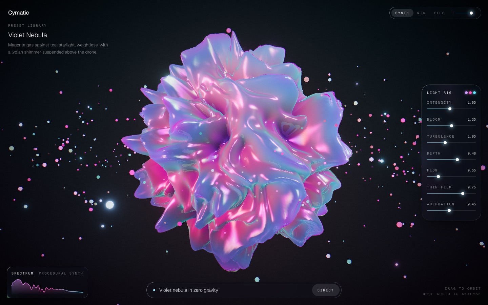

# Cymatic

An interactive spatial audio and optical light laboratory. A displaced glass sculpture sits inside a three-point light rig and reacts to sound in real time, while an AI scene director turns a sentence into a complete lighting cue and synthesizer patch.



## Highlights

- **One click to sound and light.** `[ ENGAGE ENGINE ]` starts a procedural ambient synthesizer: sub-bass drone, detuned saw pads, an LFO-swept resonant low-pass filter, a pulsing sub envelope and a convolution reverb. No assets are downloaded.
- **Any source.** Drop an MP3, WAV or OGG anywhere on the page, or switch to the live microphone. The microphone feeds the analyser only and is never routed to the speakers.
- **Custom optics.** The sculpture is a single `ShaderMaterial`. The vertex stage displaces a welded icosphere with curl-warped simplex noise and rebuilds normals by finite differences. The fragment stage combines Inigo Quilez cosine palettes, thin-film interference, wrapped diffuse lighting, back-scattered translucency and reflections of an animated Lightformer studio.
- **AI scene director.** Describe a light and a sound in the command bar, and a Zod-validated `SceneDirective` drives the palette, lights, bloom, turbulence and synth patch. Every parameter glides to its new value.
- **Never offline.** Without an `OPENAI_API_KEY`, or when the endpoint is unreachable, prompts are resolved by a deterministic semantic matcher that scores, blends and modifies a library of hand-tuned cues.

## Quick start

```bash
npm install
npm run dev
```

Open the printed URL and press `[ ENGAGE ENGINE ]`. The app is fully functional without any configuration.

To enable the language model, copy `.env.example` to `.env` and set a key:

```bash
OPENAI_API_KEY=sk-...
OPENAI_MODEL=gpt-4.1-mini
```

`OPENAI_MODEL` is optional and accepts any OpenAI model with structured output support. The dev server mounts `api/direct.ts` at `/api/direct`, so the same handler runs locally and in production.

| Script | Purpose |
| --- | --- |
| `npm run dev` | Vite dev server with the director endpoint |
| `npm run typecheck` | `tsc --noEmit` in strict mode |
| `npm run build` | Type-check and produce a production bundle in `dist/` |
| `npm run preview` | Serve the production bundle |

## Architecture

```
api/
  direct.ts                 Edge handler: structured LLM output, preset fallback
src/
  audio/
    AudioEngine.ts          Audio graph, sources, analyser, lifecycle
    AmbientSynth.ts         Procedural synthesizer voice graph
    BandTracker.ts          FFT bands, RMS and bass transient detection
  shaders/
    opticalCore.vert        Curl-warped simplex displacement, finite-difference normals
    opticalCore.frag        Cosine palette, thin film, scattering, light rig, reflections
    atmosphere.vert|frag    Backdrop gradient and volumetric halo
  scene/
    Stage.tsx               Canvas, frame driver, camera controls
    SculptureCore.tsx       Displaced mesh and shader uniforms
    OrbitalParticles.tsx    Instanced particles mapped to FFT bins
    LightingRig.tsx         Spot and point lights, animated Lightformer environment
    PostProcessingStack.tsx HDR bloom, chromatic aberration, tone mapping, vignette, grain
    sceneState.ts           Mutable target and live scene values with damping
  ai/
    directiveSchema.ts      SceneDirectiveSchema and parameter ranges
    presets.ts              Hand-tuned directives, keywords and prompt chips
    semanticMatcher.ts      Offline prompt resolution
    directiveMath.ts        Blending and clamping of directives
    directorInstructions.ts System instructions for the model
    sceneDirector.ts        Client: endpoint first, matcher on any failure
  store/
    useStudioStore.ts       Zustand store for UI state and the active directive
  hooks/                    Directive bridge and drag-and-drop
  components/hud/           Glass HUD: command bar, light controls, spectrum, source switch
```

### Data flow

```
prompt -> /api/direct -> SceneDirective -> Zustand store
                                             |-> sceneState target -> damped every frame -> uniforms, lights, effects
                                             '-> AudioEngine.applyPatch -> AudioParam glides

audio source -> AnalyserNode -> BandTracker -> uniforms, lights, particles, effects
```

React state changes only when the user acts. The render loop never touches React or Zustand: `Stage` advances the audio analysis and scene damping once per frame, and every `useFrame` callback reads those mutable values directly. The spectrum canvas runs its own `requestAnimationFrame` loop on the same analyser data.

### Scene directive

| Group | Fields |
| --- | --- |
| `palette` | `offset`, `amplitude`, `frequency`, `phase` vectors for `a + b * cos(2 * PI * (c * t + d))` |
| `lights` | `key`, `fill`, `rim` colors and overall `intensity` |
| `optics` | `bloom`, `turbulence`, `displacement`, `flow`, `iridescence`, `aberration` |
| `synth` | `rootHz`, `intervals`, `filterCutoff`, `resonance`, `lfoRate`, `subLevel` |

The same schema validates model output on the server, the response on the client, and defines the slider ranges in the HUD.

## Deployment

The project deploys to Vercel without configuration: Vite builds the client and `api/direct.ts` becomes an Edge Function. Add `OPENAI_API_KEY` in the project settings to enable the model. Without it the endpoint answers from the preset library, and on a static host with no endpoint at all the client falls back to the same matcher.

## License

[MIT](LICENSE)
